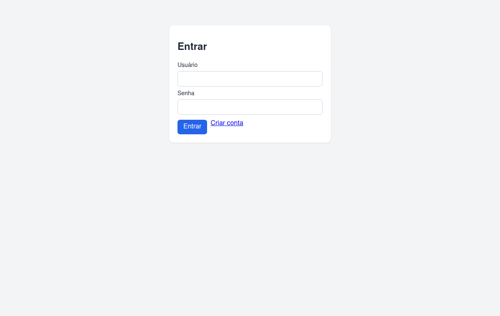
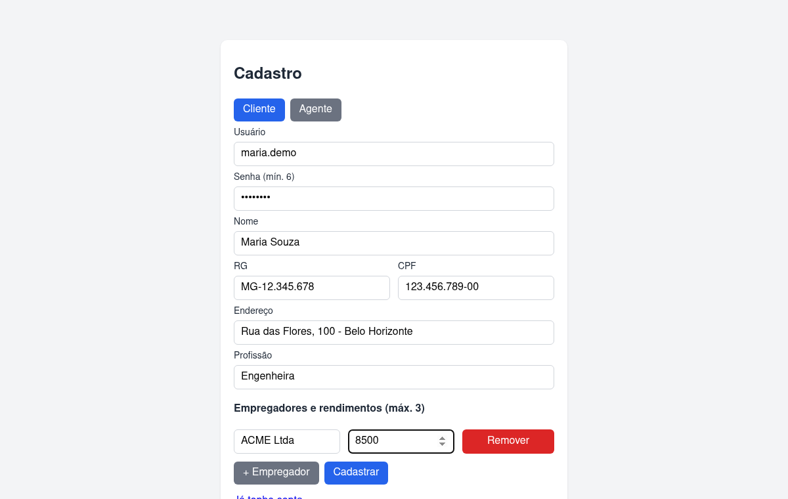
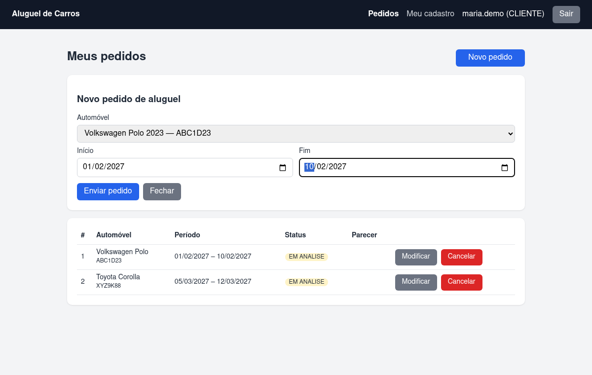
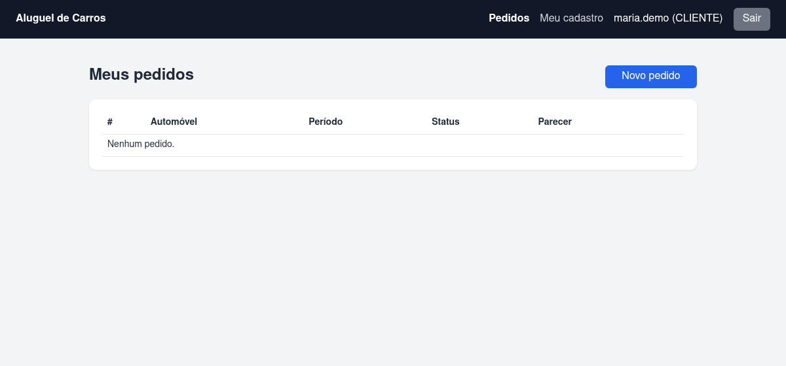
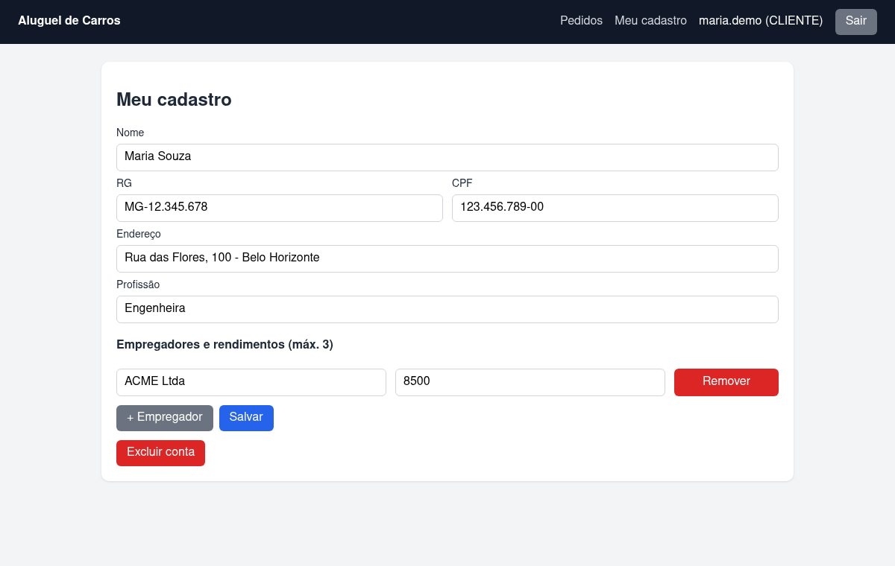
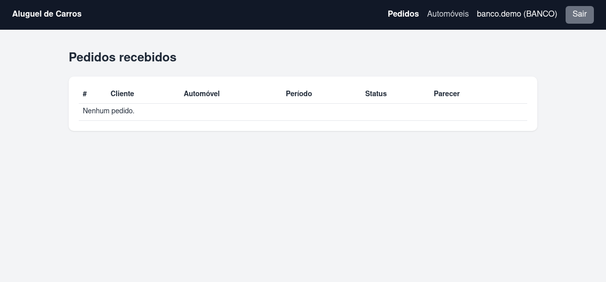
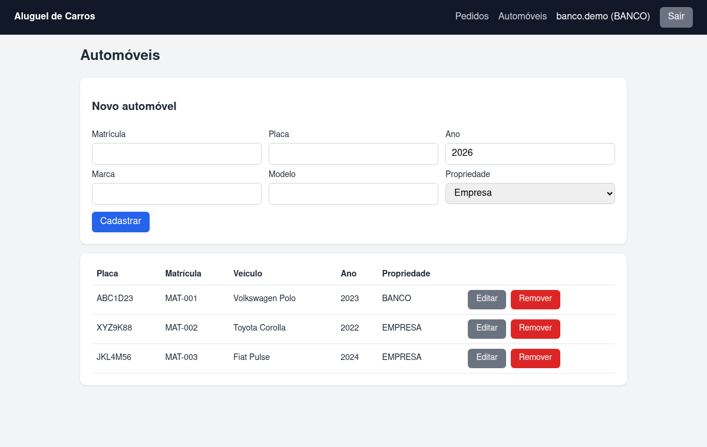

# 🚗 Sistema de Aluguel de Carros

> Sistema web para gestão de aluguéis de automóveis: clientes introduzem, modificam, consultam e cancelam pedidos; agentes (empresas e bancos) avaliam os pedidos e executam os contratos.

**Disciplina:** Desenvolvimento e Integração de Aplicações Web (DIAW) — PUC Minas · **Laboratório 02**

## 🌐 Hospedagem

| Parte | Onde | Link |
|-------|------|------|
| **Front-end (React + Vite)** | **GitHub Pages** | https://jteixeiraz.github.io/lab02-sistema-aluguel-de-carros/ |
| Banco de dados | Supabase (PostgreSQL) | — |
| **Back-end (Spring Boot)** | **Não hospedado** — roda localmente | `http://localhost:8080` |

> ⚠️ O GitHub Pages serve apenas arquivos estáticos, portanto **somente o front-end está publicado lá**. O back-end Spring Boot precisa estar em execução (localmente ou em um serviço de hospedagem Java) para que login e pedidos funcionem. Para apontar o site publicado para um back-end público, defina a variável de repositório `API_URL` (Settings → Secrets and variables → Actions → Variables) e rode o workflow *Deploy front-end no GitHub Pages*. O deploy é automático a cada push em `frontend/` ([workflow](.github/workflows/pages.yml)).

## 🚧 Status do Projeto

Protótipo funcional: autenticação, CRUD de cliente, CRUD de automóveis e fluxo de pedidos de aluguel.

## 📚 Índice

[Funcionalidades](#-funcionalidades-principais) · [Tecnologias](#-tecnologias-utilizadas) · [Arquitetura](#-arquitetura) · [Instalação](#-instalação-e-execução) · [Estrutura](#-estrutura-de-pastas) · [API](#-api) · [Modelagem](#-modelagem-uml) · [Demonstração](#-demonstração) · [Autor](#-autores)

## ✨ Funcionalidades Principais

- Cadastro e login (usuário e senha) para **clientes** e **agentes** — o sistema só é usado após autenticação.
- **Cliente:** CRUD do próprio cadastro (RG, CPF, nome, endereço, profissão e até 3 empregadores com rendimentos); criar, modificar, consultar e cancelar pedidos de aluguel.
- **Agente (empresa/banco):** listar e avaliar pedidos (aprovar/reprovar com parecer), executar contrato, e CRUD de automóveis. A aprovação por um banco registra o crédito concedido.
- Automóvel com matrícula, ano, marca, modelo, placa e proprietário (cliente, empresa ou banco).

## 🛠 Tecnologias Utilizadas

| Camada | Tecnologia |
|--------|-----------|
| Linguagem | Java — JDK 25 |
| Back-end | Spring Boot 4.0.9 (Web MVC, Data JPA, Security, Validation) |
| Build | Apache Maven (wrapper `mvnw`) |
| Front-end | React + Vite |
| Banco de dados | Supabase (PostgreSQL) |
| Autenticação | JWT stateless + BCrypt |

## 🏗 Arquitetura

Arquitetura **MVC** no back-end (`model` → `repository` → `service` → `controller`, com `dto` como contrato JSON) e SPA React consumindo a API REST. Veja [`docs/`](docs/) para os diagramas.

## 🔧 Instalação e Execução

### Pré-requisitos
JDK 25, Node.js 20+ e um banco PostgreSQL (Supabase).

### 🔑 Variáveis de Ambiente

Back-end (`backend/.env.example`):

```env
DB_URL=jdbc:postgresql://HOST:5432/postgres
DB_USER=postgres
DB_PASSWORD=change-me
JWT_SECRET=troque-por-um-segredo-com-pelo-menos-32-caracteres
AGENTE_CODIGO=codigo-de-convite-dos-agentes
```

Front-end (`frontend/.env.example`): `VITE_API_URL=http://localhost:8080/api`

Conexão com o Supabase (Project Settings → Database → *Session pooler*, compatível com IPv4):

```env
DB_URL=jdbc:postgresql://aws-0-us-east-2.pooler.supabase.com:5432/postgres?sslmode=require
DB_USER=postgres.<ID_DO_PROJETO>
DB_PASSWORD=<senha definida ao criar o projeto>
```

> O esquema é criado automaticamente pelo Hibernate (`ddl-auto=update`). Nunca versione o arquivo `.env`.

### ⚡ Como Executar

```bash
# Back-end (exporte as variáveis acima antes)
cd backend && ./mvnw spring-boot:run

# Front-end
cd frontend && npm install && npm run dev   # http://localhost:5173
```

Para cadastrar um agente, use o valor de `AGENTE_CODIGO` como código de convite.

## 📂 Estrutura de Pastas

```
backend/   Spring Boot (model, repository, service, controller, dto, security, config)
frontend/  React + Vite (pages, components, api, auth)
docs/      Casos de uso, histórias de usuário, classes e pacotes
```

## 🔌 API

| Método | Rota | Perfil |
|--------|------|--------|
| POST | `/api/auth/login`, `/api/auth/registro/cliente`, `/api/auth/registro/agente` | público |
| GET/PUT/DELETE | `/api/clientes/me` | cliente |
| GET | `/api/clientes`, `/api/clientes/{id}` | agente |
| GET | `/api/automoveis` | autenticado |
| POST/PUT/DELETE | `/api/automoveis[/{id}]` | agente |
| POST/PUT/DELETE | `/api/pedidos[/{id}]` | cliente |
| GET | `/api/pedidos` | cliente (próprios) / agente (todos) |
| PATCH | `/api/pedidos/{id}/avaliacao` | agente |

## 📐 Modelagem UML

- [Casos de uso e histórias de usuário](docs/casos-de-uso.md)
- [Diagrama de classes e estados do pedido](docs/diagrama-de-classes.md)
- [Diagrama de pacotes](docs/diagrama-de-pacotes.md)

## 🎥 Demonstração

Prints do protótipo rodando localmente com o banco no Supabase.

| Login | Cadastro de cliente |
|---|---|
|  |  |

**Cliente** — novo pedido, acompanhamento do status e edição do cadastro:





**Agente (banco)** — avaliação de pedidos (aprovação registra o crédito) e gestão de automóveis:




## 👥 Autores

- João Pedro Teixeira Reis — [@JTeixeiraz](https://github.com/JTeixeiraz)
