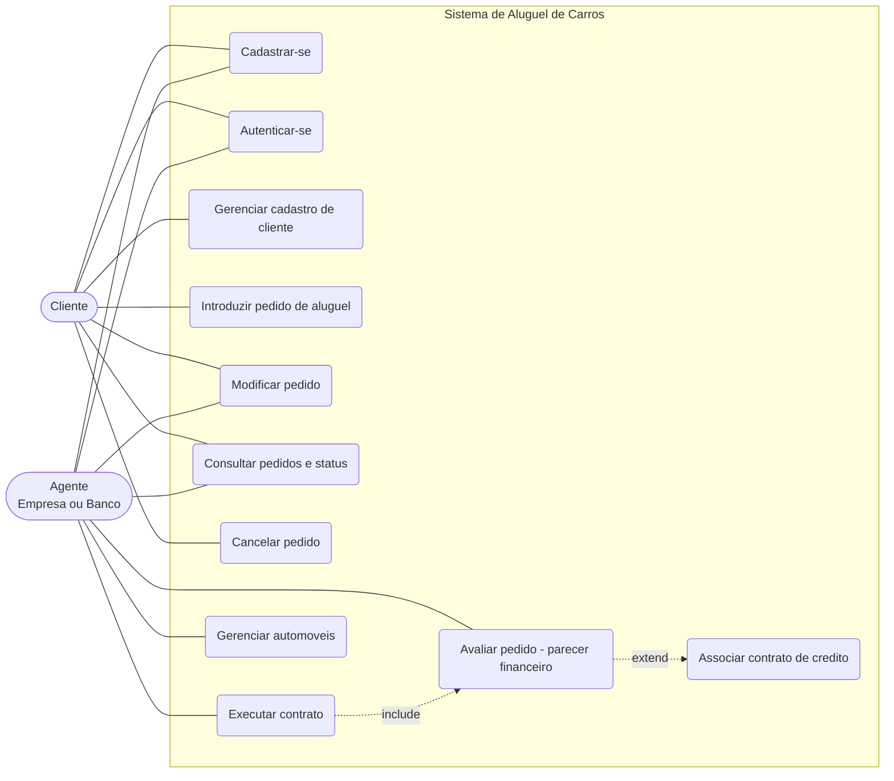

# Diagrama de Casos de Uso

## Historias de usuario

| ID | Como | Quero | Para |
|----|------|-------|------|
| HU01 | visitante | me cadastrar informando RG, CPF, nome, endereco, profissao e ate 3 empregadores com rendimentos | usar o sistema |
| HU02 | usuario | autenticar com usuario e senha | acessar apenas o que me e permitido |
| HU03 | cliente | consultar, alterar e excluir meu cadastro | manter meus dados atualizados |
| HU04 | cliente | introduzir um pedido de aluguel escolhendo automovel e periodo | alugar um carro |
| HU05 | cliente | modificar um pedido ainda em analise | corrigir periodo ou automovel |
| HU06 | cliente | consultar meus pedidos e o status de cada um | acompanhar a analise |
| HU07 | cliente | cancelar um pedido nao contratado | desistir do aluguel |
| HU08 | agente | listar os pedidos recebidos | analisa-los financeiramente |
| HU09 | agente | aprovar ou reprovar um pedido com parecer | decidir sobre o credito |
| HU10 | agente (banco) | que a aprovacao registre meu banco como concedente do credito | associar aluguel e contrato de credito |
| HU11 | agente | transformar pedido aprovado em contrato | executar o aluguel |
| HU12 | agente | cadastrar, editar e remover automoveis (matricula, ano, marca, modelo, placa, proprietario) | manter a frota |
