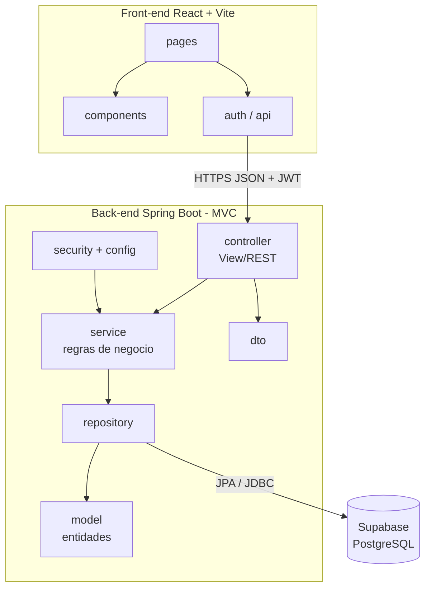

# Diagrama de Pacotes (Visao Logica)

| Camada MVC | Pacote | Responsabilidade |
|------------|--------|------------------|
| Model | `model`, `repository` | Entidades JPA e persistencia |
| View | `frontend/` (React) e `dto` | Interface e contratos JSON |
| Controller | `controller` | Endpoints REST, autorizacao por perfil |
| Servico | `service` | Regras (limite de 3 empregadores, transicoes de status) |
| Seguranca | `security`, `config` | JWT stateless, CORS, BCrypt |
